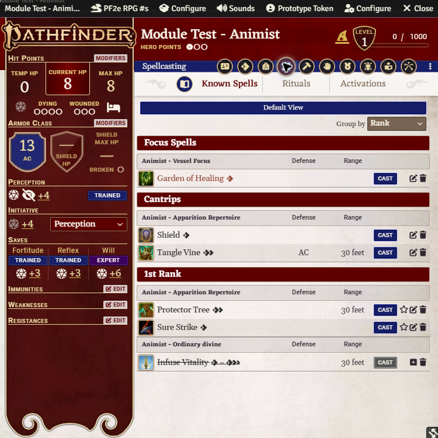
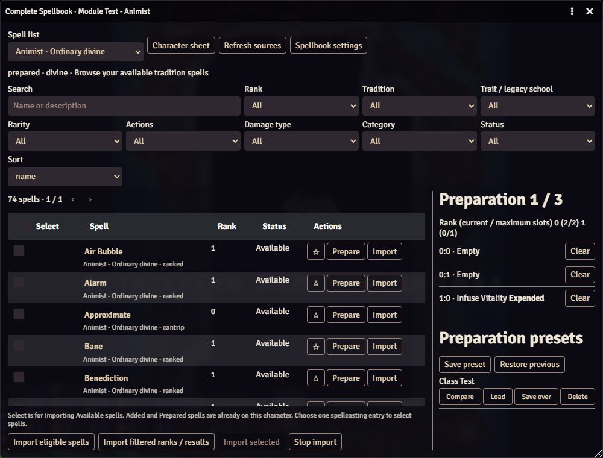
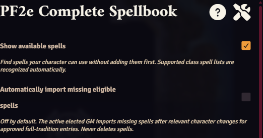

# PF2e Complete Spellbook

[](#install-locally)
[](docs/VERIFICATION.md)
[](module.json)
[](https://github.com/tom-l-mot/pf2e-complete-spellbook/actions/workflows/validate.yml)
[](LICENSE)
[](https://ko-fi.com/tomlmot)
[](https://www.patreon.com/TheOpenTableWorkshop)

Browse your available spells, prepare them for the day, and save sets you can load again later. This Foundry VTT module is built for Pathfinder Second Edition. It runs inside Foundry within the Spellcasting Tab.

**Version 0.1.0 is an installable development MVP.** It targets Foundry **14.361–14.369** within generation 14 and PF2e **8.6.1**. Live checks passed on Foundry 14.369 with PF2e 8.6.1, using test characters for eleven spellcasting classes. Full multiplayer and player-permission testing remains open. Use a test world first. The manifest does not claim a verified runtime version.

## Screenshots

These screenshots use a test character in Foundry 14.369 with PF2e 8.6.1. Colors and controls can vary with your theme and other modules.

### Sort known spells

Rank view groups focus spells, cantrips, and ranked spells across casting entries. You can also group by casting type or sort by name. **Default View** returns to the native sheet and its resource controls.



### Browse, import, and save presets

Browse available spells with search and filters, prepare individual spells, or use the import buttons below the list. The preparation panel keeps **Compare**, **Load**, **Save over**, and **Delete** together for each saved preset.



### Automatic imports

In **Game Settings → PF2e Complete Spellbook**, **Show available spells** lets supported characters browse spells without adding them first. **Automatically import missing eligible spells** is a separate option, off by default. When enabled, the elected active GM imports missing spells for approved full-tradition entries after relevant character changes.



## Install locally

1. Extract `build/pf2e-complete-spellbook.zip` into `<Foundry user data>/Data/modules/pf2e-complete-spellbook/`. `module.json` must sit directly in that folder.
2. Restart Foundry when no game is in progress, then enable **PF2e Complete Spellbook** in a PF2e test world's module settings.
3. Open a character sheet. On the **Spellcasting** tab, click the round book icon to the left of **Known Spells**. A script macro is also available:

   ```js
   const actor = canvas.tokens.controlled[0]?.actor ?? game.user.character;
   if (actor) game.modules.get("pf2e-complete-spellbook").api.open(actor);
   ```

## Set up a character

Open the spellbook. It recognizes a supported class's ordinary spell list when the character has one matching prepared list with cantrips. Druid, Animist, Witch, and Magus ordinary preparation is ready automatically. Clerics can browse their tradition spells and prepare cantrips immediately. Wizards keep their learned spells, and Unified Magical Theory preparation is ready automatically.

Cleric font slots and Wizard school slots, including bonus cantrips, may have special rules. PF2e does not label those slots, so the GM checks any uncertain ranks once in **Spellbook settings**. Check a rank only when every slot in it is for ordinary spells. Leave mixed or special ranks unchecked and manage them on the character sheet. Magus Studious Spells also needs this check.

The screen uses labeled checkboxes, with no spell IDs or comma-separated numbers to enter. If multiple lists, archetypes, or custom entries make the class match unclear, it asks which spell list belongs there. Existing GM choices remain in place. A changed slot layout needs another check for a manually configured list.

Clerics, Druids, and prepared Animists can browse permitted tradition spells. Wizards, Witches, and Magi keep the spells they have learned. Spontaneous, focus, innate, apparition, and flexible ranked preparation remain on the character sheet.

Automatic recognition is conservative, but PF2e's generic entries cannot prove the meaning of custom slots. Review **Spellbook settings** when using a custom setup. A spell list's name or slot count is never proof that its special slots are safe.

## Browse, import and prepare

- Search names and descriptions. Filter rank, tradition, traits or legacy schools, rarity, action cost, damage, category and status. Sort by name or rank. Lists show 100 rows per page.
- Choose **All entries** for a unified view. Every row retains its destination entry. Focus and innate entries display their existing spells; the category menu filters spell kinds.
- Hover over a spell's name to read a short description. Click its name for the full PF2e details. Stars store favorites per character using source identities that survive import. Recent status lists the last 20 spells prepared through this module, not casts from other sheets.
- **Prepare** lets you select an approved compatible slot, including a higher rank. An Available spell is added to the character when needed. Expended slots stay expended. **Clear** also preserves the expended state.
- **Import eligible spells** previews every missing eligible spell. **Import filtered ranks / results** applies current filters; **Import selected** uses checked rows. The checkbox beside **Select** selects all available spells matching your filters, across every page. Confirmation is required before import starts. **Stop import** stops between document writes. Completed imports remain intact and a retry skips them.
- Existing owned spell documents are never overwritten or deleted. Identical sources in different entries remain separate, because PF2e associates each owned spell with one entry.

## Sort the character sheet's known spells

On **Spellcasting**, click **Sort spells** to combine native known spell rows across entries. Choose **Rank**, **Casting type**, or **Name**. Rank view shows focus spells, then cantrips, then ordinal rank headings with source entry groups alphabetized internally. Casting type groups prepared, spontaneous, innate, and focus spells. Source subheaders identify each entry, including repeated prepared slots. Name view stays alphabetical across all entries. Source subheaders retain cast rank in Casting type and Name views.

Sorted views hide native entry controls, resource configuration, empty slots, and the create-entry button. Use **Default view** to restore the original layout or drag spells and entries. The view preference stays in this browser for this user and character. Sorting does not write actor data. If the native layout is unsupported, the module leaves it unchanged.

## Preparation presets

Save the approved slots in the selected entry as a named preset, such as Combat or Exploration. Presets persist as character flags. Compare a preset against current preparation or another saved preset without changing slots. Loading also shows a comparison against the current preparation before confirmation.

**Load**, adjust preparation slots, then **Save over** the same preset to edit it. Save over confirms the named target, keeps its name and ID, and replaces only its approved assignments. Other presets remain unchanged, and overwriting works when the character already has 50 presets. **Delete** confirms the named preset and removes only that saved preset; current preparation and the previous preparation backup stay unchanged. Delete also works when current preparation slots are not approved.

Loading validates every target and spell, saves previous assignments separately per entry, then writes all affected ranks in one entry update while preserving expended flags. **Restore previous** offers the same preview and validation. A missing spell, changed entry or unapproved slot refuses the load. Presets do not perform daily rest or restore resources. Avoid simultaneous edits or casting from another client while applying a preset.

## Settings

The GM controls virtual discovery, allowed compendium IDs, uncommon/rare access, legacy inclusion, imports, presets, favorites, cache duration and debug logging. The default source is `pf2e.spells-srd`. Pack visibility still applies. The default rarity filter is a client display preference and cannot expand access.

**Automatically import missing eligible spells** is off by default. Enabling it allows the elected active GM to fill approved full-tradition entries after relevant character changes. It never deletes spells or changes slot capacity. Browsing automatically reflects changes even when physical synchronization is off.

## Build and verify

Use Node.js 22.18 or later. Node 24 is used in CI.

```sh
npm ci
npm run check
```

`check` runs strict TypeScript checks, automated tests, bundle creation and ZIP content validation. `npm test` runs the core and adapter tests with Node's test runner. `npm run package` writes `build/module.json` and `build/pf2e-complete-spellbook.zip`. Runtime dependencies are zero; build tools are development-only.

On filesystems that reject npm package extraction, copy the source to a normal local folder and run the same commands there. Keep the resulting lockfile and release artifacts with the project. This development run encountered Google Drive `EBADF` errors and used a temporary local copy for dependency-backed checks.

## Manifest URL distribution

The source is saved in [tom-l-mot/pf2e-complete-spellbook](https://github.com/tom-l-mot/pf2e-complete-spellbook). No installable GitHub release is published yet. The local manifest omits download URLs until release assets exist.

When this repository is published under an owner-approved GitHub repository, the supplied release workflow builds URLs from `GITHUB_REPOSITORY`, validates the version tag, and creates a **draft** release for `v0.1.0`. Publish the reviewed release and use its `module.json` asset URL in Foundry's **Install Module → Manifest URL** field. That manifest points to the versioned ZIP and a latest-release manifest for updates. Do not paste a guessed URL before those assets exist.

## Project structure

```text
src/
  core.ts          Eligibility, filters, slot rules, preset validation
  runtime.ts       Compendium cache, document adapter, imports, persistence
  app.ts           ApplicationV2 UI and dialogs
  main.ts          Sheet hooks, refresh and optional synchronization
  settings.ts      Settings registration
  foundry.d.ts     Narrow runtime API declarations
templates/         Handlebars application template
styles/            Scoped responsive styles
lang/              English localization
tests/             Core, adapter and artifact tests
scripts/           Build and ZIP validation
docs/              Architecture, manual testing and decision trail
.github/workflows/ Validation and draft release packaging
```

## Known limits and production readiness

- Ambiguous spell lists and ranks with possible special slots need a GM check. Manually approved slot-layout changes need another check.
- Animist prepared divine discovery works after approval. Existing apparition and vessel entries remain distinct. Attunement, dispersion, primary-apparition changes and gift synchronization require the PF2e sheet or existing tools.
- Flexible ranked collection selection, learning/repertoire edits, casting, focus/innate resources, rituals, staff/item casting and special slots remain native workflows. No direct compendium casting is claimed.
- Cross-client import races and concurrent native-sheet writes do not have a server transaction. Operate one character from one editing client during imports and preset application.
- This module respects Foundry permissions through its own operations. It cannot prevent an actor owner from using other Foundry features or arbitrary JavaScript to alter their actor.
- Run the [live test matrix](docs/MANUAL_TESTING.md), including player permissions, mixed casting entries, theme/keyboard behavior and disablement, before broad use. Publish release assets only after that validation. Wider PF2e version support requires rechecking the adapter.

Disabling the module leaves imported spells and preparation data in standard PF2e items. Its stored flags remain inert. No migration or cleanup deletion runs on disablement.

See [RESEARCH.md](RESEARCH.md) for source links and licenses and [architecture](docs/ARCHITECTURE.md) for policy and failure contracts. This project is unofficial and not endorsed by Paizo or Foundry Gaming.

## Spell status

**Available** means you can add the spell to this character. **Added** means it is already on the character. **Prepared** means it is assigned to a preparation slot. Import checkboxes appear only for Available spells. Wizard spellbooks show their existing learned spells, so Added and Prepared rows do not have import checkboxes.

## Support development

If you'd like to support development and maintenance, you can [buy me a coffee on Ko-fi](https://ko-fi.com/tomlmot). Thanks for your support!
